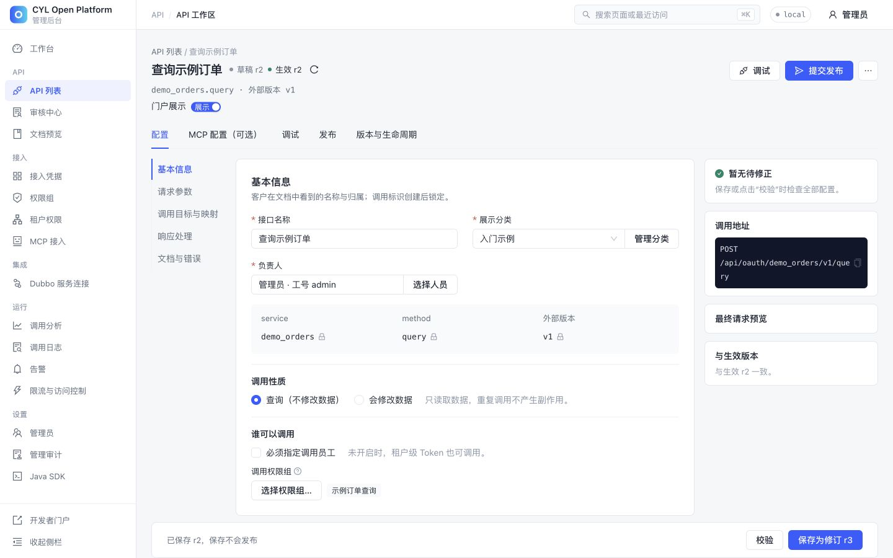
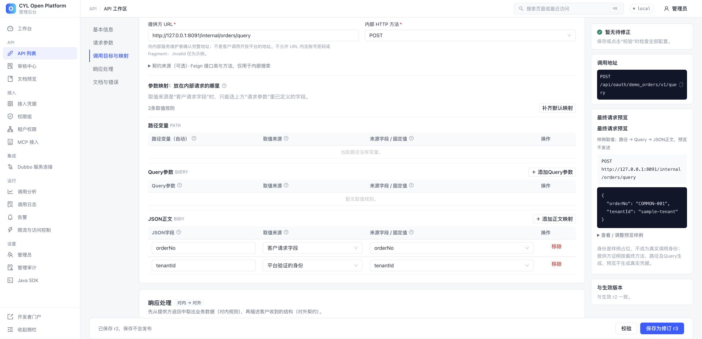
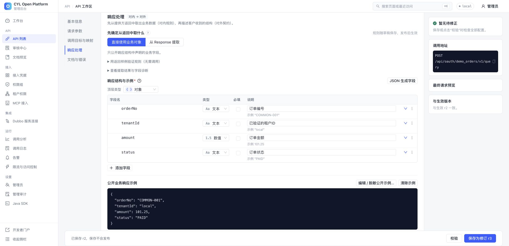
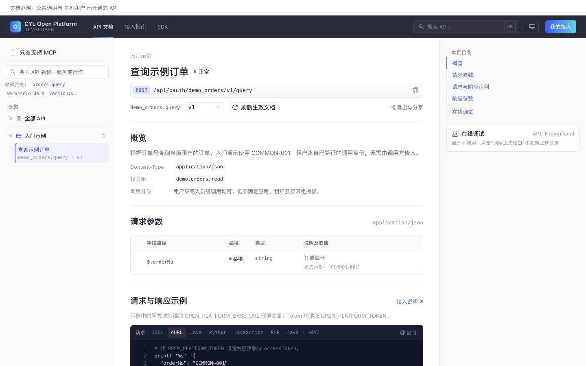
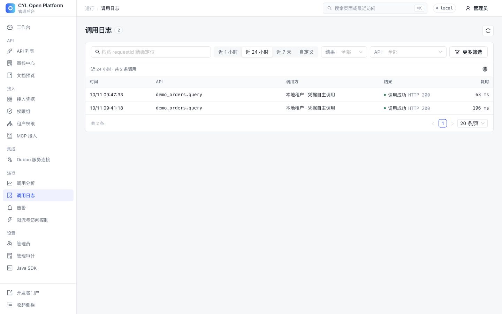
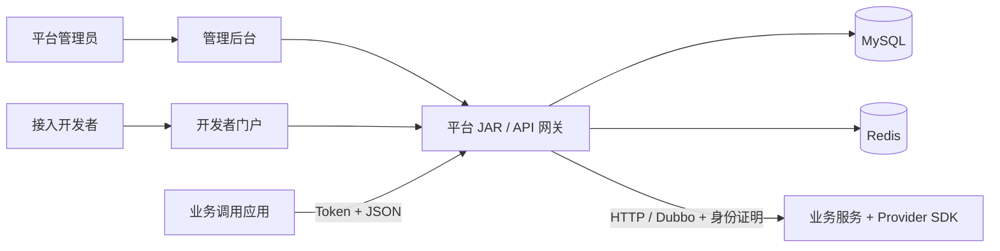

<div align="center">
  <h1>CYL Open Platform</h1>
  <p><strong>面向 HTTP / Dubbo 服务的 API 开放与治理平台</strong></p>

[](LICENSE)   [](docs/status.md)

<p>
  <a href="docs/quickstart.md">安装指南</a> ·
  <a href="docs/first-api.md">跑通 Demo</a> ·
  <a href="docs/README.md">完整文档</a> ·
  <a href="https://github.com/ChenYilei2016/cyl-openplatform/issues">问题反馈</a>
</p>
</div>

> 把已有业务服务接入统一网关，在同一工作流内完成 API 配置、审核发布、租户授权、开发者文档和调用追踪。管理后台与门户随平台打包，部署一个 JAR；业务服务独立运行。

**快速导航：** [界面预览](#界面预览) · [核心能力](#已实现能力) · [快速开始](#快速开始) · [运行 Demo](#再走一步真的调用一次-api) · [架构与接入](#架构与接入) · [文档索引](#文档入口)

当前为 **0.1.0-SNAPSHOT 开发版**，通过源码构建运行。尚未提供托管演示站、应用镜像或 Maven Central 正式制品；[支持与验证范围](docs/status.md)单独列出。

## 界面预览

### API 工作区：从契约到发布

在同一工作区配置输入输出、HTTP / Dubbo 目标和字段映射，核对草稿与发布基线。保存产生草稿，审核通过后的发布版本才用于正式调用。



#### 入参映射：把请求字段与可信身份交给业务服务

`orderNo` 取自客户请求，`tenantId` 取自平台验证的身份，再组装为 Provider 的 JSON 正文。右侧可预览最终请求；预览中的 `sample-tenant` 是样例占位，不是真实调用身份。



#### 出参映射：定义客户最终收到的数据

在“响应处理”中选择直接使用业务对象或从 Response 提取数据，并声明公开字段、类型和样例。下图使用订单示例的直接返回方式，展示四个公开字段和业务响应示例。




<details>
<summary><strong>开发者门户：查看契约、调用示例与在线调试</strong></summary>

发布后的接口按可见范围展示，接入方可以查看字段、请求示例和调试入口；文档可见性与调用授权独立。



</details>

<details>
<summary><strong>运行追踪：从一次调用定位到请求记录</strong></summary>

调用记录连接网关请求与提供方结果，可按 requestId 排查授权、路由和业务响应。



</details>

截图使用本仓真实运行的虚构订单示例，可按 [Demo 教程](docs/first-api.md)复现。查看 [全部界面与说明](docs/screenshots.md)。

## 项目定位

- 让多个租户、合作方或业务系统按授权调用统一的 API。
- 把现有 HTTP / Dubbo 服务接入标准 JSON API，管理参数映射和返回结构。
- 为接入方提供可浏览的 API 文档、调用示例、调试入口与 SDK 资产。
- 把接口草稿、审核、生效版本、回滚和运行记录串起来，方便协作与排障。

它不提供用户注册/找回密码、计费商城或完整 IAM；也不替代业务服务自身的数据权限检查。MCP 能力是平台侧的工具描述与授权契约，外部 MCP 网关需单独接入。能力边界见 [功能与概念](docs/user-guide.md)。

## 已实现能力

| 能力 | 已有实现 |
| --- | --- |
| API 工作区 | HTTP / Dubbo 绑定、OpenAPI / cURL / 平台 JSON 导入、参数与返回结构、字段映射、草稿校验和调试 |
| 发布与生命周期 | 不可变发布快照、审核、启停、历史修订恢复、回滚、废弃/退出及跨环境交付 |
| 接入与授权 | 应用凭据、租户绑定、权限组、租户权限、员工委托、Token 与可选请求签名 |
| 开发者门户 | 公开/授权范围文档、请求示例、在线调试、我的接入、文档导出与 SDK 资产 |
| 运行治理 | 调用记录与 requestId、统计分析、告警、限流和访问控制规则 |
| 扩展 | 浏览器身份、账号认证、人员目录 SPI；提供方接入 SDK；可选 Nacos 服务发现 |

## 快速开始

### 安装材料与初始账号

所有安装输入都随仓库公开提供。下载源码后，在你自己的环境生成密码和密钥，无需维护者的私有文件。

| 内容 | 位置与说明 |
| --- | --- |
| **数据库初始化 SQL** | [sql/init.sql](sql/init.sql)，完整 44 张表与首位管理员资格；[手动导入与核对](sql/README.md) |
| **初始登录** | 用户名 `admin`；密码由你运行初始化脚本时输入，**没有公共默认密码**；[保存位置与重置](docs/quickstart.md#管理员密码在哪里) |
| **配置模板** | [application.example.properties](config/local/application.example.properties)；初始化脚本生成实例专属配置，初次使用无需手动复制 |
| **Demo API 数据** | [order-query.json](examples/first-api/order-query.json) 与 [first-api.py](scripts/demo/first-api.py)，通过正式接口创建、发布并调用 |

`.env`、私有配置与 `.local` 是在使用者环境生成的文件，不作为 GitHub 下载前提。具体生成步骤见 [文件来源说明](docs/quickstart.md#仓库文件与本机生成文件)。

**准备：** JDK 25、Maven 3.8+、Node.js 22.13+、pnpm 11.12、Python 3.9+、OpenSSL、Docker Compose v2。平台在宿主机运行，Compose 只启动 MySQL / Redis。首次下载依赖需要访问 Maven Central 与 npm。

```bash
git clone https://github.com/ChenYilei2016/cyl-openplatform.git
cd cyl-openplatform

# 输入自己的初始管理员密码；不内置通用默认密码。
python3 scripts/setup-local.py
# 先确保 Docker 已启动。
docker compose up -d --wait
bash scripts/build.sh
bash scripts/run-local.sh
```

| 入口 | 默认地址 |
| --- | --- |
| 管理后台 | <http://127.0.0.1:18080/admin/> |
| 开发者门户 | <http://127.0.0.1:18080/portal/> |
| 健康检查 | <http://127.0.0.1:18080/actuator/health> |

账号为 `admin`，密码是初始化时输入的值。看到健康状态 `UP`、能够登录并打开工作台，即完成平台启动。数据库和 Redis 的本机端口是 `13306` / `16379`。Compose 在空数据卷首次启动时自动导入仓库的 [sql/init.sql](sql/init.sql)；密码和密钥由你生成并保存在 Git 忽略的文件中。

已有配置时不要再次初始化；`docker compose down` 保留数据卷。环境安装、停止/重启、端口冲突、Windows 和手动数据库方式见 [完整启动指南](docs/quickstart.md)。

### 再走一步：真的调用一次 API

平台保持运行，在第二个终端进入刚克隆的 `cyl-openplatform` 目录，启动仓库提供的订单服务：

```bash
bash scripts/run-example-provider.sh
```

等待 Provider 健康检查返回 `UP`，在第三个终端进入同一仓库目录后执行（会在你的开发环境创建演示分类、权限、API、发布和凭据）：

```bash
python3 scripts/demo/first-api.py
```

成功输出包含：

```json
{"orderNo":"COMMON-001","tenantId":"local","amount":101.25,"status":"PAID"}
```

这条路径包含真实独立 Provider 调用。脚本中的每一步都对应正式 HTTP 接口；手工页面操作、授权关系、配置示例和失败恢复见 [第一个 API](docs/first-api.md)。

## 架构与接入



一次调用依次经过：**应用凭据 → 租户与权限校验 → 已发布 API → 参数映射 → Provider 验证身份 → 业务响应与调用记录**。账号登录用于管理平台，AppKey / AppSecret 用于应用接入；两者独立。

| 接入角色 | 下一步 |
| --- | --- |
| 提供业务服务 | [Provider SDK](openapi-provider-sdk/README.md)：配置信任公钥，接入 HTTP / Dubbo 服务 |
| 编写调用程序 | [Token / 签名与调用示例](docs/api-access.md)、[Java 客户端样例](examples/java-client) |
| 接入其他身份体系 | [身份 SPI](docs/identity-spi.md)：替换账号认证、浏览器身份与人员目录 |
| 部署和维护平台 | [配置参考](docs/configuration.md)、[账号 / 备份 / 升级](docs/operations.md) |

后端采用 Java 25 / Spring Boot 4 / MyBatis-Plus，前端采用 React / TypeScript / Vite / Ant Design。默认启动使用本地账号、MySQL 和 Redis，不依赖 Nacos 或第三方账号服务。模块职责见 [架构说明](docs/architecture.md)。

## 文档入口

| 你想做什么 | 阅读 |
| --- | --- |
| 从零安装并确认启动成功 | [快速开始](docs/quickstart.md) |
| 查看、手动导入或维护初始化 SQL | [数据库初始化](sql/README.md) |
| 从发布到第一次真实调用 | [第一个 API](docs/first-api.md) |
| 理解菜单、版本、权限和门户 | [使用手册](docs/user-guide.md) |
| 使用 Token、签名或人员委托 | [调用与鉴权](docs/api-access.md) |
| 接入自己的 HTTP / Dubbo 服务 | [Provider SDK](openapi-provider-sdk/README.md) |
| 修改数据库、端口、超时和环境参数 | [配置参考](docs/configuration.md) |
| 部署、备份、升级或管理账号 | [运维指南](docs/operations.md) |
| 配置MCP网关、服务发现或跨环境交付 | [进阶集成](docs/integrations.md) |
| 接入其他身份系统 | [身份 SPI](docs/identity-spi.md) |
| 遇到启动、403、发布或调用错误 | [常见问题](docs/faq.md) |
| 修改源码或提交贡献 | [开发指南](docs/development.md) · [贡献指南](CONTRIBUTING.md) |

## 参与项目

欢迎提交 [Bug](https://github.com/ChenYilei2016/cyl-openplatform/issues/new?template=bug_report.yml)、[功能建议](https://github.com/ChenYilei2016/cyl-openplatform/issues/new?template=feature_request.yml) 和 [Pull Request](https://github.com/ChenYilei2016/cyl-openplatform/pulls)。请提供版本、复现步骤和脱敏的 requestId；不要公开凭据或真实业务数据。

本地质量检查与 CI 命令见 [开发指南](docs/development.md)。支持范围和当前限制见 [项目状态](docs/status.md)，变更记录见 [CHANGELOG](CHANGELOG.md)，安全问题见 [SECURITY](SECURITY.md)。

采用 [Apache License 2.0](LICENSE)。第三方依赖保留各自许可证。
