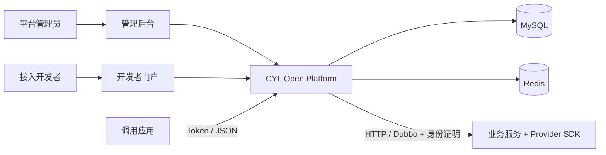

# CYL Open Platform

**把内部 HTTP / Dubbo 服务，变成可授权、可发布、可追踪的开放 API。**

CYL Open Platform 是面向服务提供方和接入开发者的 API 开放平台。它提供管理后台、开发者门户和运行时网关，将 API 配置、版本发布、租户授权、调用凭据与运行治理放在同一个工作流里。

[快速开始](docs/quickstart.md) · [完成第一次调用](docs/first-api.md) · [使用手册](docs/user-guide.md) · [完整文档](docs/README.md) · [问题反馈](https://github.com/ChenYilei2016/cyl-openplatform/issues)

**版本状态：`0.1.0-SNAPSHOT`，开发阶段。** 当前通过源码构建运行；暂不提供已发布的 Maven Central 制品、预构建应用镜像或托管演示站。默认发行版使用本地账号，支持通过 SPI 接入其他身份体系。


## 适合做什么

- 让多个租户、合作方或业务系统按授权调用统一的 API。
- 把现有 HTTP / Dubbo 服务接入标准 JSON API，管理参数映射和返回结构。
- 为接入方提供可浏览的 API 文档、调用示例、调试入口与 SDK 资产。
- 把接口草稿、审核、生效版本、回滚和运行记录串起来，方便协作与排障。

它不提供用户注册/找回密码、计费商城或完整 IAM；也不替代业务服务自身的数据权限检查。MCP 能力是平台侧的工具描述与授权契约，外部 MCP 网关需单独接入。能力边界见 [功能与概念](docs/user-guide.md)。

## 核心功能

| 能力 | 已有实现 |
| --- | --- |
| API 工作区 | HTTP / Dubbo 绑定、OpenAPI / cURL / 平台 JSON 导入、参数与返回结构、字段映射、草稿校验和调试 |
| 发布与生命周期 | 不可变发布快照、审核、启停、历史修订恢复、回滚、废弃/退出及跨环境交付 |
| 接入与授权 | 应用凭据、租户绑定、权限组、租户权限、员工委托、Token 与可选请求签名 |
| 开发者门户 | 公开/授权范围文档、请求示例、在线调试、我的接入、文档导出与 SDK 资产 |
| 运行治理 | 调用记录与 requestId、统计分析、告警、限流和访问控制规则 |
| 扩展 | 浏览器身份、账号认证、人员目录 SPI；提供方接入 SDK；可选 Nacos 服务发现 |

## 界面预览


截图来自本仓真实运行的本机演示，使用虚构订单和独立账号；未包含 AppSecret、Token 或私钥。更多界面见 [截图导览](docs/screenshots.md)。

## 快速开始

**准备：** JDK 25、Maven 3.8+、Node.js 22.13+、pnpm 11.12、Python 3.9+、OpenSSL、Docker Compose v2。平台在宿主机运行，Compose 只启动 MySQL / Redis。首次下载依赖需要访问 Maven Central 与 npm。

```bash
git clone https://github.com/ChenYilei2016/cyl-openplatform.git
cd cyl-openplatform

# 输入自己的初始管理员密码；不内置通用默认密码。
python3 scripts/setup-local.py
# 先确保 Docker 已启动。
docker compose up -d --wait
bash scripts/build.sh
bash scripts/run-local.sh
```

| 入口 | 默认地址 |
| --- | --- |
| 管理后台 | <http://127.0.0.1:18080/admin/> |
| 开发者门户 | <http://127.0.0.1:18080/portal/> |
| 健康检查 | <http://127.0.0.1:18080/actuator/health> |

账号为 `admin`，密码是初始化时输入的值。看到健康状态 `UP`、能够登录并打开工作台，即完成平台启动。数据库和 Redis 的本机端口是 `13306` / `16379`，初始化产物均被 Git 忽略。

已有配置时不要再次初始化；`docker compose down` 保留数据卷。环境安装、停止/重启、端口冲突、Windows 和手动数据库方式见 [完整启动指南](docs/quickstart.md)。

### 再走一步：真的调用一次 API

平台保持运行，在第二个终端启动仓库提供的订单服务：

```bash
bash scripts/run-example-provider.sh
```

在第三个终端执行（会在当前本机环境创建演示分类、权限、API、发布和凭据）：

```bash
python3 scripts/demo/first-api.py
```

成功输出包含：

```json
{"orderNo":"COMMON-001","tenantId":"local","amount":101.25,"status":"PAID"}
```

这条路径包含真实独立 Provider 调用。脚本中的每一步都对应正式 HTTP 接口；手工页面操作、授权关系、配置示例和失败恢复见 [第一个 API](docs/first-api.md)。

## 架构与技术



后端采用 Java 25 / Spring Boot 4 / MyBatis-Plus，前端采用 React / TypeScript / Vite / Ant Design。平台以一个包含前端资源的 JAR 部署，业务提供方独立运行。默认启动不依赖 Nacos 或第三方账号服务。详见 [架构说明](docs/architecture.md)。

## 文档入口

| 你想做什么 | 阅读 |
| --- | --- |
| 从零安装并确认启动成功 | [快速开始](docs/quickstart.md) |
| 从发布到第一次真实调用 | [第一个 API](docs/first-api.md) |
| 理解菜单、版本、权限和门户 | [使用手册](docs/user-guide.md) |
| 使用 Token、签名或人员委托 | [调用与鉴权](docs/api-access.md) |
| 接入自己的 HTTP / Dubbo 服务 | [Provider SDK](openapi-provider-sdk/README.md) |
| 修改数据库、端口、超时和环境参数 | [配置参考](docs/configuration.md) |
| 部署、备份、升级或管理账号 | [运维指南](docs/operations.md) |
| 配置MCP网关、服务发现或跨环境交付 | [进阶集成](docs/integrations.md) |
| 接入其他身份系统 | [身份 SPI](docs/identity-spi.md) |
| 遇到启动、403、发布或调用错误 | [常见问题](docs/faq.md) |
| 修改源码或提交贡献 | [开发指南](docs/development.md) · [贡献指南](CONTRIBUTING.md) |

## 参与项目

欢迎提交 [Bug](https://github.com/ChenYilei2016/cyl-openplatform/issues/new?template=bug_report.yml)、[功能建议](https://github.com/ChenYilei2016/cyl-openplatform/issues/new?template=feature_request.yml) 和 [Pull Request](https://github.com/ChenYilei2016/cyl-openplatform/pulls)。请提供版本、复现步骤和脱敏的 requestId；不要公开凭据或真实业务数据。

本地质量检查与 CI 命令见 [开发指南](docs/development.md)。支持范围和当前限制见 [项目状态](docs/status.md)，变更记录见 [CHANGELOG](CHANGELOG.md)，安全问题见 [SECURITY](SECURITY.md)。

采用 [Apache License 2.0](LICENSE)。第三方依赖保留各自许可证。
