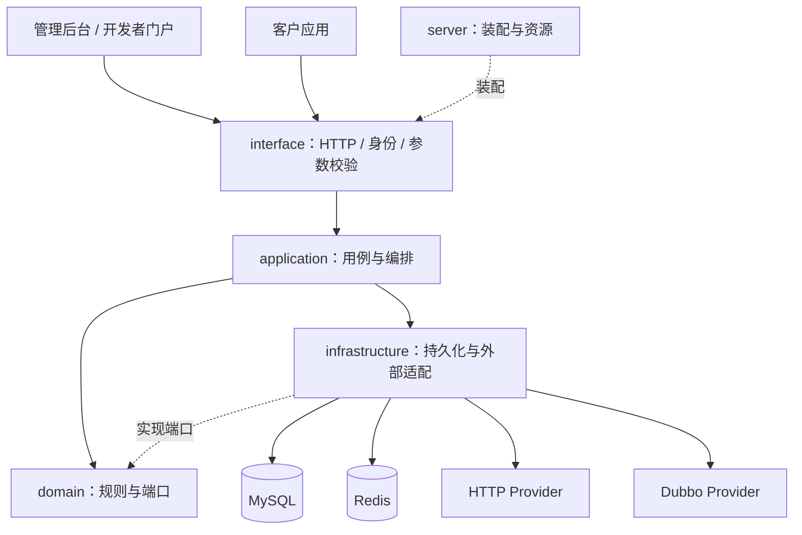

# 架构与数据流

[文档首页](README.md) / 架构

## 部署组成

平台以单个Spring Boot JAR运行，包含后台、门户、管理接口和API网关。MySQL保存配置、发布、授权与记录；Redis承载运行时协调/治理等能力。业务Provider独立部署，HTTP和Dubbo走同一平台授权与治理链。

图中的应用到基础设施表示运行时协作；Java模块的源码依赖通过领域/应用端口和装配边界组织，不应反向把SQL或外部SDK引入领域。

## 模块地图

| 目录 | 主要职责 |
| --- | --- |
| `cyl-openplatform-domain` | 业务对象、权限和生命周期规则、存储/人员端口 |
| `cyl-openplatform-application` | 事务与用例编排、发布、Token、调用流程 |
| `cyl-openplatform-infrastructure` | MyBatis-Plus Repository、Redis、HTTP/Dubbo、账号实现、配置绑定 |
| `cyl-openplatform-interface` | Controller、可信会话、参数校验、统一响应和错误映射 |
| `cyl-openplatform-server` | 启动、JSON/Web装配、前端打包、集成测试 |
| `cyl-openplatform-admin-web` | 管理后台 |
| `cyl-openplatform-portal-web` | 开发者门户 |
| `cyl-openplatform-web-shared` | UI令牌、通用组件和接入视图 |
| `openapi-provider-sdk` | 提供方身份验证与协议适配 |
| `examples` | 独立订单Provider、Java客户端和第一API配置 |

Java根包与Maven groupId为`io.github.chenyilei2016`。Provider SDK核心基于Java8；平台宿主采用JDK25，这不是要求所有业务Provider升级到Java25。

## 三条核心路径

1. **配置发布：** 管理会话 → 管理权限 → 草稿校验/引用核验 → 保存修订 → 提交固定发布快照 → 审核 → 生效版本。
2. **API调用：** Token或签名 → 当前应用/租户/人员授权 → 生效配置 → 权限/治理 → 输入与映射 → HTTP/Dubbo → 返回处理 → 调用记录。
3. **身份扩展：** 浏览器身份SPI取得当前事实 → 请求内管理/门户会话；员工委托通过人员目录SPI核验；数据库资格决定管理权限。

## 关键设计约束

- 公开对象ID按字符串传输，避免JavaScript整数精度损失。
- 草稿、发布快照与当前生效指针是不同对象；历史快照不被后续编辑覆盖。
- 配置变更使用修订/状态版本作并发保护，重试先确认已有结果。
- 租户和人员身份从已验证上下文取值，参数映射不能把客户端输入当成可信身份。
- Provider使用平台签名证明，仍需自行检查业务数据属于哪个租户/人员。
- 单JVM浏览器会话不等于多实例会话已共享；默认Nacos关闭，注册发现是可选配置。

默认账号实现与私有身份接入方式见 [身份SPI](identity-spi.md)。所有已验和未验的部署形态见 [项目状态](status.md)。
