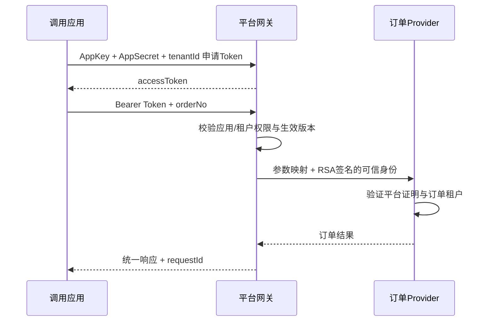

# 第一个 API：从发布到真实调用

[文档首页](README.md) / [快速开始](quickstart.md) / 第一个 API

目标：把仓库的订单查询服务接入平台，发布 `demo_orders / v1 / query`，用应用凭据获取Token，得到订单响应。示例使用虚构订单数据，只有本机开发环境写入。

## 先认识这条链路



管理员浏览器登录只用于配置平台；程序调用使用AppKey/AppSecret换取Token，两者不能替代。

## 示例材料在哪里

| 随仓库提供 | 用途 |
| --- | --- |
| [订单 API JSON](../examples/first-api/order-query.json) | 入参、出参、HTTP 绑定及身份映射；owner 是待替换的档案 ID，占位处理由脚本完成 |
| [演示初始化脚本](../scripts/demo/first-api.py) | 创建权限、分类、API、发布和应用凭据，并验证一次调用 |
| [订单 Provider 源码](../examples/order-provider) | 独立 Java 服务，内置虚构订单；无需另找业务数据库或导入订单 SQL |
| [Provider 启动脚本](../scripts/run-example-provider.sh) | 使用你初始化时生成的公钥启动示例服务 |

演示数据通过正常接口创建，不在 SQL 中预置 AppSecret 或发布快照。`.local/state/demo/first-api.json` 是脚本执行后写到**你电脑**的结果与凭据，不是要从 GitHub 下载的输入文件。

## 前提

1. 已按 [快速开始](quickstart.md) 启动平台，健康检查为UP。
2. 使用初始 `admin` 账号；默认租户为 `local`，拥有API/凭据管理、发布和审核权限。
3. 已完成完整构建，存在 `examples/order-provider/target/example-order-provider-exec.jar`。
4. `8091`（Provider HTTP）和`20881`（示例Dubbo）没有被其他进程占用。

## 方式一：先运行完整示例

保留平台终端。在第二个终端、仓库根目录运行：

```bash
bash scripts/run-example-provider.sh
```

脚本从初始化生成的**公钥**构建临时Provider配置，使用 `local-platform` key-id、`local` environment-id 和 `local` 示例租户，不读取平台私钥。运行配置写到 `.local/runtime/order-provider.properties`。它启动真实HTTP/Dubbo服务，不需要Nacos。

```bash
curl -f http://127.0.0.1:8091/actuator/health
```

第三个终端先进入同一仓库根目录，再运行：

```bash
python3 scripts/demo/first-api.py
```

输入平台管理员密码。脚本只接受回环HTTP地址；默认平台 `http://127.0.0.1:18080`。它调用正式接口依次创建：

| 资源 | 示例值 / 行为 |
| --- | --- |
| 权限组 | `demo.orders.read`，启用，非公共权限，不自动授予所有新凭据 |
| 租户权限 | 为当前管理员所属租户开通该权限组 |
| 分类与负责人 | 创建“入门示例”分类，使用当前已验证人员的稳定档案ID |
| API草稿 | `demo_orders / v1 / query`，HTTP POST，查询操作 |
| 发布 | 提交当前修订；开启审核时批准该演示发布，确认APPLIED |
| 门户展示 | 打开该API的门户展示开关 |
| 调用凭据 | 创建本租户凭据，赋予示例权限组，显式绑定本租户 |
| Token与调用 | 换取Token，经网关调用真实订单Provider |

初始管理员同时有发布和审核权限，因此本机示例可完成两个动作；实际团队可分别分配权限。脚本不会修改已存在的同名用户资源，也不会修改平台的全局审核设置。

成功结果：

```text
示例API已发布，API ID：API_...
调用成功：{"orderNo": "COMMON-001", "tenantId": "local", "amount": 101.25, "status": "PAID"}
```

`AppSecret`和`accessToken`只保存到被Git忽略的 `.local/state/demo/first-api.json`。脚本不打印它们。记录中的`verified: true`表示已检查真实返回内容，不能只凭API创建成功判断接入完成。

正常复验不会重复创建业务资源：

```bash
python3 scripts/demo/first-api.py --check
```

`--check`复用演示凭据申请/复用Token并调用；可能新增Token及调用审计记录。服务停止后请先重新启动平台与Provider。

### 在页面中查看结果

打开 <http://127.0.0.1:18080/admin/>，在“API列表”搜索 `demo_orders` 或“查询示例订单”，查看草稿配置和已生效发布；在“接入凭据”查看新应用，在“调用日志”查看订单查询记录。打开 <http://127.0.0.1:18080/portal/> 并登录同一账号，即可查看已展示的接口文档。若修改过平台端口，使用实际端口。

## 方式二：按页面理解和复现

自动示例跑完后，可直接在后台查看每个对象。若完全手动创建，使用另一个服务标识避免与自动示例重名。

### 1. 准备权限组和租户权限

进入“权限组”，创建并启用`demo.orders.read`。保持“公共权限”“新凭据默认授予”关闭，再通过“租户权限”为`local`开通该权限组。

权限组存在，不等于所有应用或租户都能用。普通调用受凭据权限和应用租户绑定约束；这里另授租户权限，是为了让本租户门户/MCP范围也能看到该组。详见 [授权模型](api-access.md)。

### 2. 创建 API

在“API列表”中维护“入门示例”分类，再“新建API”。负责人选择当前管理员；不要把姓名字符串当负责人ID。

| 字段 | 值 |
| --- | --- |
| 名称 | 查询示例订单 |
| 服务 / 版本 / 方法 | `demo_orders` / `v1` / `query` |
| 类型 | HTTP；调用性质为QUERY |
| 提供方 | `POST http://127.0.0.1:8091/internal/orders/query` |
| 超时 | 3000毫秒 |
| 权限组 | `demo.orders.read` |
| 需要员工身份 | 关闭（本例验证租户级调用） |
| 返回处理 | DIRECT，Provider直接返回业务对象 |

服务名和方法名仅使用小写字母、数字和下划线，并以字母开头；不要在服务名中使用点号。完整示例结构见 [order-query.json](../examples/first-api/order-query.json)。文件中的负责人占位值必须替换为 `/admin-api/apis/owners/current` 返回的`id`；`category`使用已存在的分类名称，不是分类ID。演示脚本会自动处理。

### 3. 定义输入、输出和字段映射

外部请求只需要：

```json
{"orderNo":"COMMON-001"}
```

| 提供方目标字段 | 来源 | 路径 |
| --- | --- | --- |
| `orderNo` | REQUEST | `orderNo` |
| `tenantId` | CONTEXT | `tenantId` |

租户来自已验证Token，不能要求客户端随意提交可信身份。返回结构包含 `orderNo`、`tenantId`、`amount`、`status`，可在字段设计中填写样例与说明。

平台内部Schema格式使用大写类型（如`OBJECT`/`STRING`）和字段上的`required`布尔值。它不同于原始JSON Schema；OpenAPI文件请使用导入入口，不要直接塞入内部Schema字段。


### 4. 保存、发布和展示

保存生成草稿修订；提交发布冻结该修订的快照。默认开启审核，需在审核中心批准。确认发布状态为**已生效**，并在API列表打开“门户展示”。

保存不等于上线。审核中的快照也不会自动跟随后续草稿修改。门户展示开关只影响文档可见性，不授予调用权限。

### 5. 准备凭据并调用

在“接入凭据”创建归属租户为`local`的凭据，授予`demo.orders.read`，保管仅在创建/轮换时显示的Secret；再显式建立本租户绑定。也可通过门户“我的接入”按页面流程创建和绑定。

完整Token请求、调用示例和错误响应见 [调用与鉴权](api-access.md)。本例的网关URL是：

```text
POST http://127.0.0.1:18080/api/oauth/demo_orders/v1/query
```

成功响应的`data`应包含金额`101.25`和状态`PAID`；`requestId`可以在“调用日志”中查询。直接请求Provider受保护接口会因缺少平台证明被拒绝，这是正常的信任边界。

## 重复运行与失败恢复

- 正常完成后使用`--check`，不要再次创建示例。
- 脚本逐步保存已确认成功的资源。若状态只完成了一部分，先在后台按状态中的ID核对，再使用 `python3 scripts/demo/first-api.py --resume` 继续未记录的步骤。
- 网络中断可能发生在服务端成功、客户端未收到响应之间。此时必须先确认对象/发布是否已存在，不能删除状态文件后盲目重跑。`--resume`不是跨数据库/跨环境迁移工具。
- 如果API已经发布而Provider没有启动，启动Provider后执行`--check`即可。
- 如需清理，按状态文件中的ID在本机后台逐项核对并撤销演示资源；脚本不提供全库清空或自动删除命令。

自定义账号用`--username`，自定义平台地址用`--base-url http://127.0.0.1:端口`。Provider示例租户可通过`DEMO_TENANT_ID`设置，公钥文件通过`DEMO_PUBLIC_KEY_FILE`设置；自定义环境必须让平台与Provider的environment-id一致。Provider修改HTTP端口时，在启动脚本后传入`--server.port=新端口`，同时修改示例JSON中的目标URL；修改Dubbo端口使用`--example.order.dubbo.port=新端口`。初次使用请先保持默认端口和身份。
