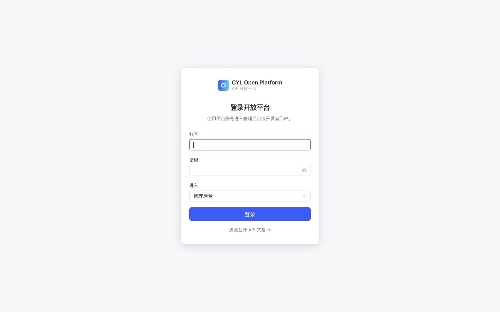

# 快速开始

[文档首页](README.md) / 快速开始 → [第一个 API](first-api.md)

目标：从全新源码启动平台、登录后台并确认依赖正常。此时数据库没有演示API，空列表是正常状态。

## 1. 检查环境

以下命令在 Bash 终端执行。macOS / Linux 可直接使用；Windows 建议使用 WSL2，并在同一WSL发行版内安装JDK/Node/Python、启用Docker Desktop的WSL集成。不要混用Windows与WSL的路径或各自的localhost。Windows原生脚本未验收。

| 工具 | 要求 | 检查命令 |
| --- | --- | --- |
| Java | JDK 25（不只是JRE） | `java -version`、`javac -version` |
| Maven | 3.8+；Maven使用的Java也须为25 | `mvn -version` |
| Node.js | 22.13+ | `node -v` |
| pnpm | 11.12.0，与仓库packageManager一致 | `pnpm -v` |
| Python | 3.9+，使用标准库 | `python3 --version` |
| OpenSSL | 支持 `genpkey` 和 `pkey` | `openssl version` |
| Docker / Compose | Docker可运行，Compose v2支持`--wait` | `docker info`、`docker compose version` |

缺少pnpm时，可在已有Node后执行 `npm install -g pnpm@11.12.0`。本仓Maven命令显式使用公共仓库配置；npm默认registry.npmjs.org。未承诺最低内存容量，首次Java编译、前端安装与数据库同时运行需留出足够内存和磁盘空间。

## 2. 获取源码并初始化

```bash
git clone https://github.com/ChenYilei2016/cyl-openplatform.git
cd cyl-openplatform
python3 scripts/setup-local.py
```

**此后所有命令默认从仓库根目录执行。** 输入12至256字符的初始管理员密码并确认；终端不回显密码。脚本生成：

| 文件 | 用途 | 是否进入Git |
| --- | --- | --- |
| `config/local/private/application.properties` | 数据库密码、本地账号摘要、Provider私钥 | 否 |
| `config/local/private/provider-public.pem` | 提供方信任公钥 | 否 |
| `.env` | Compose所需的MySQL密码 | 否 |
| `.local/init/01-platform.sql` | 全新数据库建表与首位管理员 | 否 |

脚本不会连接数据库。已有配置时会拒绝覆盖，这是保护既有账号和数据；继续使用现有配置即可，不要为通过初始化而删除文件。非交互方式支持 `--password-file /path/to/password.txt`，文件由使用者提供并妥善保管。

## 3. 启动依赖

先启动Docker，然后执行：

```bash
docker compose up -d --wait
docker compose ps
```

预期mysql、redis均为healthy。Compose只运行两项基础依赖，平台JAR仍在宿主机运行：

| 服务 | 宿主机地址 | 容器内端口 |
| --- | --- | --- |
| MySQL 8.4 | `127.0.0.1:13306` | 3306 |
| Redis 7.4 | `127.0.0.1:16379` | 6379 |

数据库名 `cyl_openplatform`、应用数据库用户 `cyl`。初始化SQL仅在**空数据卷首次初始化**时执行。已有卷不会因重启重新导入SQL，修改 `.env` 也不会自动修改已有MySQL用户的密码。

## 4. 构建并运行

```bash
bash scripts/build.sh
bash scripts/run-local.sh
```

首次构建会下载依赖；完成后可找到 `cyl-openplatform-server/target/cyl-openplatform-server.jar`。脚本构建包含前端的JAR，但使用`-DskipTests`，不等于执行了全量回归。完整测试命令在 [开发指南](development.md)。

启动日志应出现 `Started OpenPlatformApplication`，另开终端验证：

```bash
curl -f http://127.0.0.1:18080/actuator/health
```

预期响应包含 `"status":"UP"`。打开 <http://127.0.0.1:18080/admin/>，以 `admin` 和第2步设置的密码登录。初始管理员有全部七项业务管理权限和总管理员资格。门户入口是 <http://127.0.0.1:18080/portal/>。



## 5. 停止、重启与修改端口

- 当前前台终端按 `Ctrl+C` 停止平台，再运行 `bash scripts/run-local.sh` 即可重启。
- `docker compose stop` 停止依赖，`docker compose start` 重新启动。
- `docker compose down` 移除容器/网络但保留数据卷；不要为了修复普通启动问题增加`-v`。
- 平台改端口：`bash scripts/run-local.sh --server.port=18081`。前端开发代理和调用地址也要调整。
- MySQL/Redis端口冲突：同时调整Compose宿主机映射和私有配置中的对应连接地址，不要停止其他项目的进程。

## 不使用 Docker

可使用独立 MySQL 8.4 和 Redis；创建空库与专用用户，授予本库必要权限，导入 `.local/init/01-platform.sql`，然后修改私有配置。不要导入到已有业务库。

```bash
# 用你自己的数据库账号交互输入密码，不把密码写在命令行。
mysql --host=127.0.0.1 --port=3306 --user=YOUR_DB_USER --password   --default-character-set=utf8mb4 cyl_openplatform < .local/init/01-platform.sql
```

数据库和用户必须提前创建；上述命令只导入表与初始授权。首次建库采用utf8mb4字符集。当前已实际验收独立本机MySQL/Redis；Compose与不同操作系统验证状态见 [项目状态](status.md)。

## 启动成功后

继续 [第一个 API](first-api.md)，在独立订单服务上完成发布、授权和调用。遇到依赖连接、密码或页面错误，先看 [FAQ](faq.md)，不要从删除数据卷或重建配置开始。
