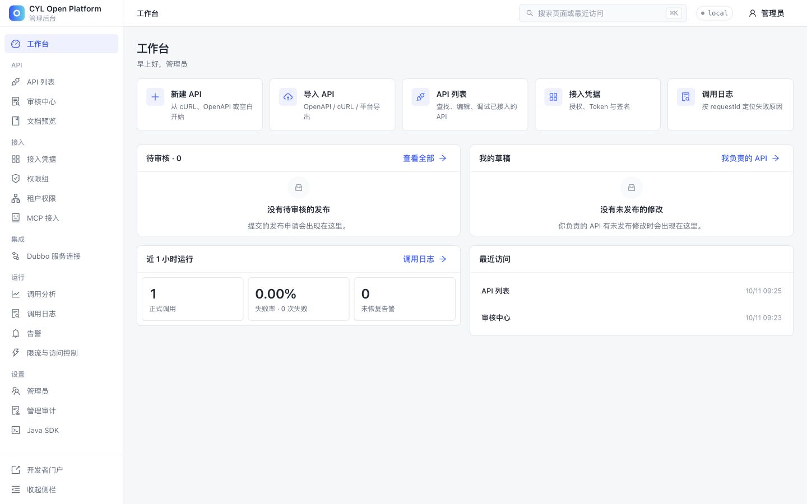
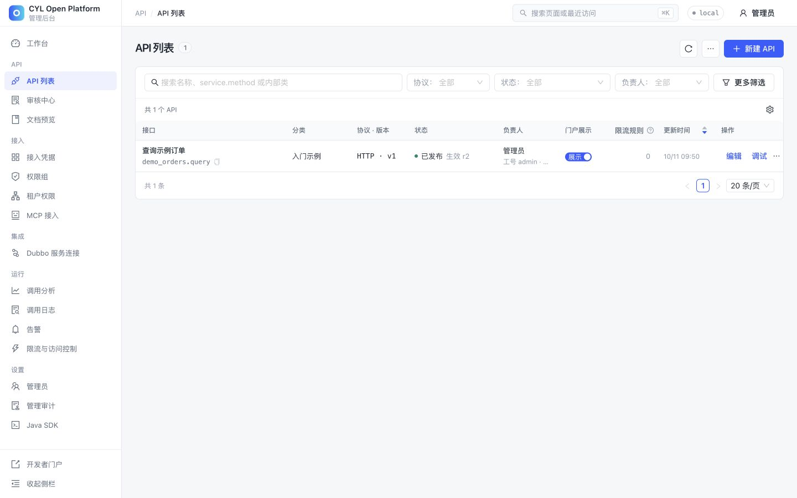
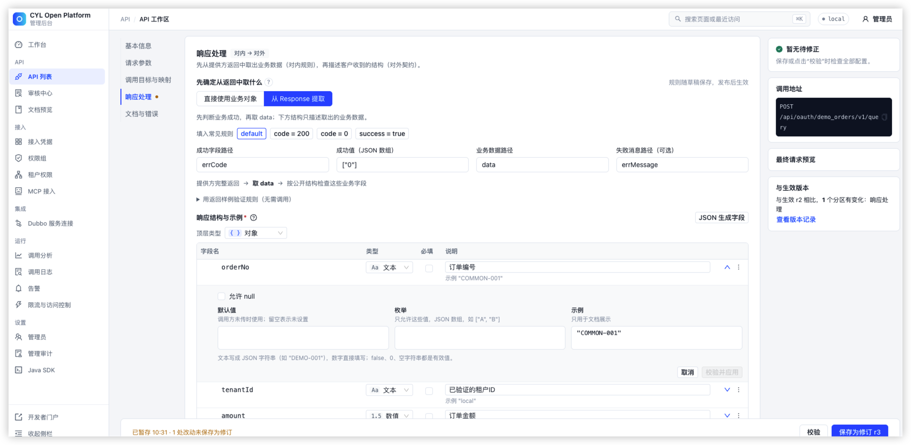
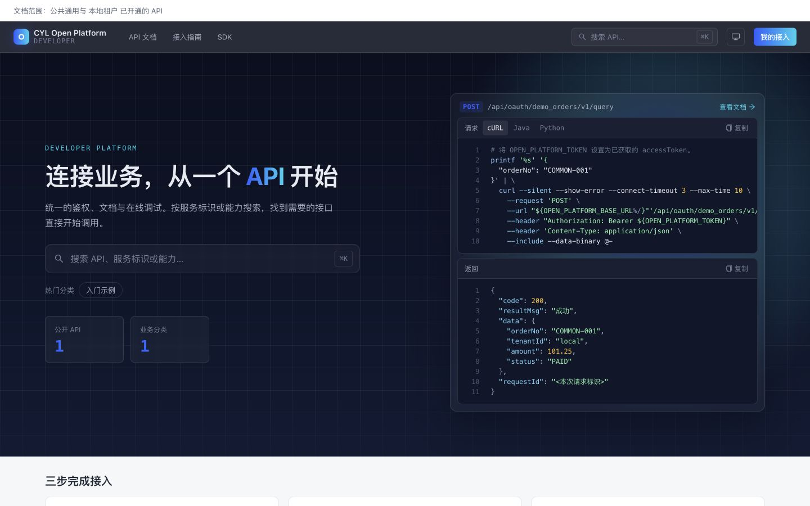

# 界面截图导览

[文档首页](README.md) / 界面截图

截图来自本仓当前界面与独立本机演示数据，没有拼接功能或伪造返回结果。复现步骤见 [第一个API](first-api.md)，素材来源见 [图片记录](images/README.md)。截图中的时间、请求号和修订号会随操作变化。

## 登录

使用自己的平台账号进入后台或门户。初始密码由初始化过程设置，不是公开默认密码。


## 工作台

集中查看常用操作、待审核、本人草稿和最近运行情况；数字来自实际数据。



## API 列表

查看草稿与生效状态、分类、负责人、门户展示及调试入口。



## API 工作区

按基本信息、参数、目标映射、响应和文档组织编辑，同时展示发布基线与待修正项。


### 入参映射

“调用目标与映射”将 `orderNo` 从客户请求映射到提供方正文，将 `tenantId` 从平台验证的身份写入正文。右侧最终请求预览使用样例值，不会调用提供方，也不会生成真实凭据。


### 出参映射（响应处理）

“从 Response 提取”先判断提供方业务状态，再取出业务数据，最后按公开结构生成统一响应。

| 规则 | 本图示例 |
| --- | --- |
| 成功字段路径 | `errCode` |
| 成功值 | `["0"]`，字符串 `"0"` 与数字 `0` 不同 |
| 业务数据路径 | `data` |
| 失败消息路径 | `errMessage`，仅供管理诊断 |

截图由维护者提供，展示工作区未保存的编辑态；“用返回样例验证规则”尚未展开。入门订单 Provider 本身直接返回业务对象，仍使用 DIRECT 配置；下面带外壳的 JSON 专门用于演示 ENVELOPE 规则，不是修改其真实返回。



#### 提供方返回与最终响应对照

在“用返回样例验证规则（无需调用）”中粘贴以下 JSON，再点击“预览返回处理”：

```json
{
  "errCode": "0",
  "errMessage": "成功",
  "data": {
    "orderNo": "COMMON-001",
    "tenantId": "local",
    "amount": 101.25,
    "status": "PAID"
  }
}
```

规则校验通过后，“公开响应”展示如下结果（`requestId` 每次生成，下方使用占位值）：

```json
{
  "code": 200,
  "resultMsg": "成功",
  "data": {
    "orderNo": "COMMON-001",
    "tenantId": "local",
    "amount": 101.25,
    "status": "PAID"
  },
  "requestId": "本次预览请求号"
}
```

“提取后 data”只包含内层订单对象；`errCode` / `errMessage` 不会照搬为公开字段。上述输入输出已通过平台的响应预览接口验证。预览不调用 Provider，也不保存或发布当前草稿。


## 开发者门户

首页展示可见范围中的接口与接入示例；此图使用已登录的演示租户范围，不表示所有接口都匿名公开。



## 文档详情

已发布契约包含用途、字段、示例和在线调试入口。示例中的Token均为环境变量占位，不是有效凭据。


## 调用日志

真实示例调用落入日志，可按requestId定位，区分平台状态与提供方结果。


