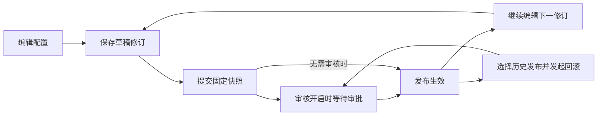

# 使用手册

[文档首页](README.md) / 使用手册。新用户建议先完成 [第一次调用](first-api.md)，再阅读本页。

## 1. 先分清六个对象

| 对象 | 解决的问题 | 不等同于 |
| --- | --- | --- |
| 平台账号 | 谁在后台/门户操作 | 程序调用凭据 |
| 管理员资格 | 这个人能管理哪些功能 | 业务API访问权限；总管理员也不会自动获得所有业务权限 |
| 应用凭据 | 哪个接入应用在调用，拥有哪些权限组 | 某个租户或某个人 |
| 租户绑定 | 该应用是否被允许代表目标租户调用 | 应用自身权限组、门户文档范围 |
| 权限组 | 对API能力进行分组授权 | 后台菜单权限 |
| 发布快照 | 客户端当前调用哪一版配置 | 最新草稿或文档编辑内容 |

人员委托是应用在特定租户下代表某个人调用的额外授权。仅当API要求员工身份或映射依赖员工上下文时使用；普通租户级查询不必强加人员参数。

## 2. 后台菜单怎么用

| 菜单 | 典型任务 | 所需业务权限 |
| --- | --- | --- |
| 工作台 | 查看待审核、本人草稿、运行摘要 | 有效管理会话，内容按权限展示 |
| API列表 / 工作区 | 创建/导入、分类、负责人、参数、映射和调试 | `MANAGE_APIS` |
| 审核中心 | 查看提交、审核、发布状态 | 发布`PUBLISH_APIS`；审核`REVIEW_APIS` |
| 接入凭据 | 创建、启停、权限组、租户绑定、员工委托、Secret轮换 | `MANAGE_APPLICATIONS` |
| 权限组 / 租户权限 | 维护分组、公共属性和租户可用范围 | `MANAGE_APPLICATIONS` |
| Dubbo服务连接 | 维护注册发现/元数据连接和修订 | `MANAGE_CONNECTIONS` |
| 调用分析 / 日志 / 管理审计 | 查询统计、请求号及变更记录 | 查询通常为`VIEW_AUDIT` |
| 告警 / 限流与访问控制 | 编辑运营与治理规则 | `MANAGE_OPERATIONS` |
| 管理员 | 总管理员分配/回收管理资格和业务权限 | 总管理员资格 |
| Java SDK / 文档预览 | 查看或维护接入资产、发布文档 | 按对应读取/管理权限显示 |

以上用于理解职责，不替代服务端权限矩阵；隐藏菜单不能充当鉴权。每个管理入口由 `@RequireAdmin` 明确策略，最终以服务端校验为准。

## 3. API 工作区

推荐顺序：**基础信息 → 接入绑定 → 请求/响应字段 → 参数映射 → 校验与调试 → 保存 → 发布**。

- **分类**先在分类管理维护；改名不会把同一分类误当新分类。
- **负责人**从已核验人员中选择，使用稳定档案ID；姓名仅展示。
- **HTTP绑定**可使用固定URL或服务名发现。固定URL适合首次接入；服务名需要相应注册发现配置。
- **Dubbo绑定**选择受控连接及修订，填写提供方应用、接口、方法、版本/分组和精确参数类型；重载方法不能只填方法名。
- **字段结构**同时用于输入校验、文档和调试。不要将员工ID、租户ID作为客户端可以覆盖的可信上下文。
- **返回处理**：`DIRECT`直接采用业务对象；`ENVELOPE`按显式成功路径/成功值/数据路径提取。数字`0`与字符串`"0"`不同。
- **调用性质**：明确设置查询`QUERY`或变更`MUTATION`。不要为了让客户端重试而把有副作用的API标成查询。
- **调试**执行真实请求，应选用隔离数据；草稿调试不等于正式版本已生效。

完整请求配置见 [示例JSON](../examples/first-api/order-query.json)。导入来源支持OpenAPI、cURL和平台导出；先检查转换结果，再保存，不把导入成功等同于业务契约正确。

## 4. 版本、发布和回滚

| 动作 | 改变什么 |
| --- | --- |
| 保存 | 生成或保留草稿修订，不自动切换正式流量 |
| 提交发布 | 固定该次修订、说明和提交幂等键 |
| 审核通过 | 生效该发布快照；后续草稿改动不混入快照 |
| 恢复历史修订 | 把历史内容恢复为可编辑草稿，仍需发布 |
| 回滚发布 | 发起受控的生效版本切换，遵循审核配置 |
| 停用 | 阻止该API正式调用，保留历史数据 |
| DEPRECATED | 已废弃但仍可调用，应按公告迁移 |
| RETIRED | 已退出，调用返回410 |

废弃计划日期用于说明，不应假设时间一到会自动执行停用或退出。`expectedRevision`/`expectedStateVersion`用于并发保护；遇到409先读取最新状态，不能把数字随意加一后重复提交。

跨环境交付需目标分类、有效负责人、权限组和连接均准备好，且两个环境配有机器间信任配置。共享MySQL不意味着共享同一个API环境；不同environment-id的草稿、发布和门户展示隔离。

## 5. 凭据、租户和人员

1. 在“接入凭据”创建凭据并选择权限组。Secret只在创建/轮换时显示，应交给对应接入方保管。
2. 明确建立应用与租户的绑定；凭据归属租户不等于已经获得目标租户绑定。
3. 需要员工调用时，在该租户绑定下核验工号并建立人员委托。身份从服务端目录核验，输入姓名/用户ID不授予身份。
4. 启停应用、回收绑定、变更权限或人员身份后，旧Token可能失效；客户端应重新取得有效身份，不应无限重试401/403。
5. “租户备注”是当前租户关系的展示说明，不会修改所有租户共享的授权事实。

**普通API权限与门户/MCP范围是两条明确的规则：** 普通Token/签名调用使用应用权限组和应用租户绑定；门户/MCP使用租户权限组或公共权限组。一个API有多个权限组时，当前调用范围与其中至少一个有效组匹配即可。具体链路见 [调用与鉴权](api-access.md)。

## 6. 门户为什么看不到接口

门户展示至少要核对：当前逻辑环境、有效发布、接口状态、门户展示开关和当前文档范围。匿名公开文档受公共权限组范围约束；已登录租户可查看其可用范围的文档。登录后台不会自动让所有API都公开。

“我的接入”用于本租户凭据及绑定管理；“退出门户”关闭当前工作区，“退出登录”注销平台服务端会话并影响后台。应用Token与浏览器登录不是同一身份。

## 7. 调用日志与治理

调用失败先保留`requestId`、HTTP状态、业务错误码和发生时间，在“调用日志”中定位对应阶段：鉴权、权限组、输入校验、参数映射、提供方、返回处理或治理拒绝。

日志中的有界脱敏摘要不是业务原始报文备份。统计需要实际调用产生数据，首次启动为0是正常状态。限流和访问控制先保存草稿、核对预览后发布；不要把保存规则理解为已经作用于流量。

## 8. MCP、签名和 SDK 的边界

- MCP页配置工具说明和接入资格，具体流程见 [进阶集成](integrations.md)；仓库不内置一个可替代任意外部MCP网关的托管服务。外部网关需对接平台专用凭据和接口。
- 请求签名是普通Bearer调用之外的独立入口，启用前配置签名密钥保护参数；其协议头保留已有命名，不能自行更改。
- 页面“Java SDK”用于接入资产；仓库`openapi-provider-sdk`用于内部服务验证平台身份。两种SDK的使用者与密钥不同，见 [SDK说明](../openapi-provider-sdk/README.md)。
